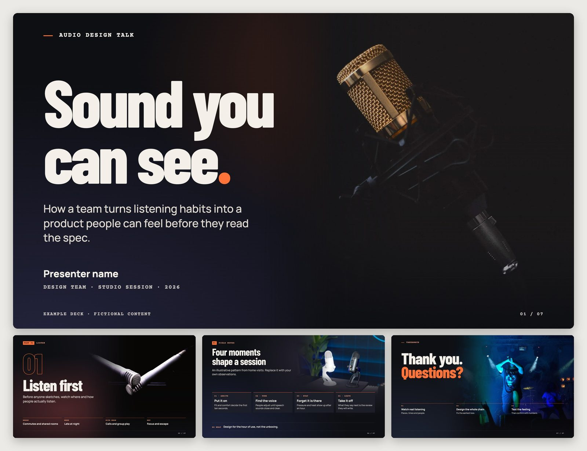
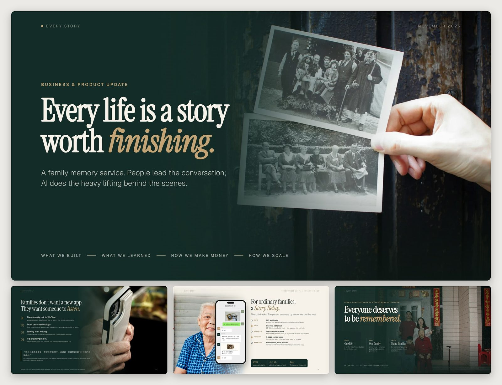

# Visual Slides

**Presentations that look designed, not generated.** An open-source Agent Skill for Claude that turns a brief, a document or an old deck into a polished presentation, with a strong real image on every slide.

[](LICENSE)
[](https://code.claude.com/docs/en/skills)
[](https://github.com/NinnaCao/visual-slides/releases/latest)



## Why

Most AI-made decks look the same: walls of bullets, generic stock photos, text overflowing its box. Visual Slides works the way a designer does:

1. **It reads everything first.** Before choosing a single image, it reads the whole deck or brief and decides where the pictures should come from.
2. **It finds the right images.** A brand or product deck uses the brand's own website imagery. A topic deck gets real, documentary photos from the web. Your own work uses your own photos. Every image is credited automatically.
3. **Every slide gets an excellent visual.** Photos fade softly into the background instead of sitting in hard boxes. Diagrams and text-heavy slides still get a photo, dimmed behind the content.
4. **It checks its own work.** Every slide is rendered in a real browser and checked for overlapping or clipped text, broken or blurry images, and slides without a visual, before you ever see it.

## Made with Visual Slides



## Get started

**Claude Code:** copy the `visual-slides` folder into `~/.claude/skills/` (or your project's `.claude/skills/`).

**Claude (web and desktop apps):** download the ZIP from the [latest release](https://github.com/NinnaCao/visual-slides/releases/latest), then go to **Customize > Skills > Upload a skill**.

Then just ask:

> Use Visual Slides to turn this report into a 12-slide talk for our leadership team. HTML and PDF.

> Make a 15-slide deck about AI in elderly care. Find real photos for every slide.

> Redesign this deck (attached) for a product launch. Use our brand's website imagery.

## What you get

| | |
| --- | --- |
| **Outputs** | Single-file HTML deck (works offline, scales to any screen), pixel-exact PDF, PowerPoint, speaker notes |
| **Styles** | Chosen for each brief: Cinematic Night (dark, condensed, glowing), editorial, light, plus 46 more directions, or your brand |
| **Images** | Brand websites, Openverse, Wikimedia Commons, Unsplash and Pexels (with a key); licenses checked, credits slide generated |
| **Motion** | Staged entrances, traced diagrams, photos that settle in; optional autoplay; respects reduced motion |
| **Languages** | English and Chinese, with proper CJK typography and font subsetting |
| **Quality checks** | Static checks plus a rendered pass over every slide, with a contact sheet |

## How it works

```
read the whole content → content brief + image plan → find & credit images
→ build the deck (fades, diagrams, motion) → render & check every slide → export HTML / PDF / PPTX
```

Under the hood it is a set of instructions plus small, dependency-light Python scripts you can also run yourself:

```bash
cd visual-slides
python3 scripts/build_deck.py assets/example-cinematic-deck.json /tmp/deck.html   # build
python3 scripts/check_deck.py /tmp/deck.html                                      # static checks
python3 scripts/qa_render.py /tmp/deck.html /tmp/qa                               # render + check every slide
python3 scripts/export_pdf.py /tmp/deck.html /tmp/deck.pdf                        # pixel-exact PDF
python3 scripts/find_images.py "night train" --out media/candidates/train         # open-licence image search
python3 scripts/collect_page_images.py https://brand.example/product --out media/candidates/brand
```

The builder needs only Python 3.10+. Optional: `pip install pillow playwright fonttools brotli` for image conversion, rendering checks, PDF export and font subsetting.

## FAQ

**Can I use the images in my deck?** The skill keeps only images whose license fits (CC0, CC BY, CC BY-SA, Unsplash, Pexels, or brand imagery for presentations about that brand) and lists every source on a generated credits slide. Brand website imagery is for presentations about that company; check the brand's terms before publishing such a deck.

**Does it work without Claude?** The scripts run on their own, and the instructions work in other assistants that load Agent Skills.

**Is it free?** Yes. MIT licensed.

## Credits

Created by [Ninna Cao](https://github.com/NinnaCao). The fixed 16:9 browser stage builds on [Frontend Slides](https://github.com/zarazhangrui/frontend-slides) by Zara Zhang (MIT). The complete original is included in `visual-slides/assets/source/` and `visual-slides/references/frontend-slides/`. Fonts: Barlow Condensed, Manrope and Courier Prime (SIL Open Font License). Example photos: Wikimedia Commons contributors (CC0, CC BY, CC BY-SA). See [NOTICE](visual-slides/NOTICE.md) and [credits](visual-slides/references/credits.md).

## License

[MIT](LICENSE) © 2026 Ninna Cao. Third-party parts keep their own licenses (see NOTICE).

Release notes: [CHANGELOG](visual-slides/CHANGELOG.md). To build a release ZIP: `tools/package.sh`.
